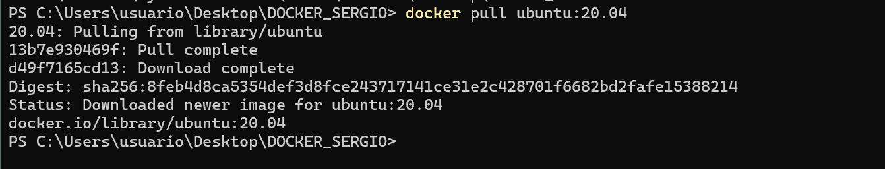
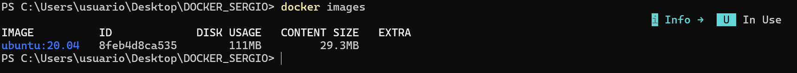
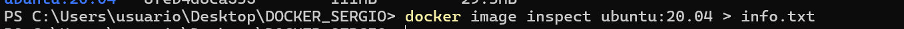
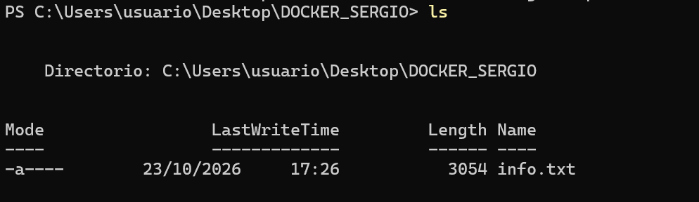
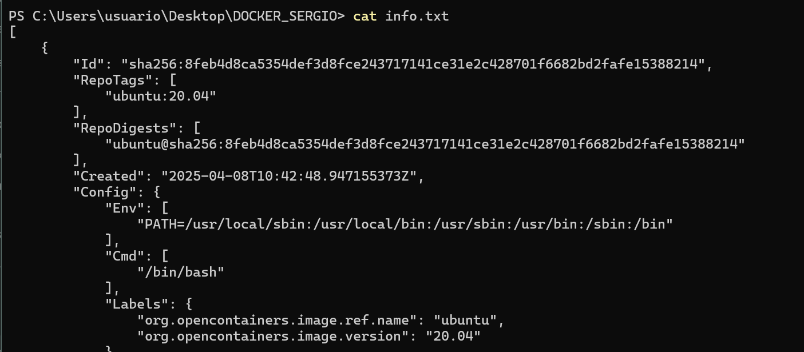
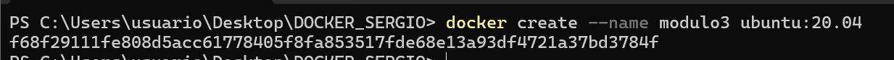

# Gestión de imágenes en Docker

Guía de documentación para descargar, inspeccionar, utilizar y eliminar
una imagen de Docker.

------------------------------------------------------------------------

## 1. Descargar la imagen de Ubuntu

Abre la terminal y ejecuta el siguiente comando para descargar la imagen
`ubuntu:20.04` desde Docker Hub:

``` bash
docker pull ubuntu:20.04
```

> **Comentario:** Este comando descarga la imagen de Ubuntu 20.04 en el
> equipo.

Para comprobar que se ha descargado correctamente, ejecuta:

``` bash
docker images
```

> **Comentario:** Busca `ubuntu` en la columna `REPOSITORY` y `20.04` en
> la columna `TAG`.

------------------------------------------------------------------------

## 2. Guardar la información de la imagen

Ejecuta el siguiente comando para consultar la información detallada de
la imagen y guardarla en el fichero `info.txt`:

``` bash
docker image inspect ubuntu:20.04 > info.txt
```

> **Comentario:** El símbolo `>` guarda la salida del comando en un
> fichero. Si `info.txt` ya existe, su contenido se sobrescribe.

Para mostrar su contenido, utiliza:

``` bash
cat info.txt
```

------------------------------------------------------------------------

## 3. Crear un contenedor

Crea un contenedor llamado `modulo3` a partir de la imagen de Ubuntu:

``` bash
docker create --name modulo3 ubuntu:20.04
```

> **Comentario:** Este comando crea el contenedor, pero no lo inicia.

Para comprobar que se ha creado, ejecuta:

``` bash
docker ps -a
```

> **Comentario:** El parámetro `-a` muestra todos los contenedores,
> incluidos los que están detenidos. Busca `modulo3` en la columna
> `NAMES`.

------------------------------------------------------------------------

## 4. Intentar eliminar la imagen

Prueba a eliminar la imagen con el siguiente comando:

``` bash
docker rmi ubuntu:20.04
```

> **Comentario:** Si Docker indica que la imagen está siendo utilizada
> por un contenedor, no podrá eliminarse mientras ese contenedor siga
> existiendo.

En este caso, el contenedor `modulo3` utiliza la imagen. Por eso,
primero hay que eliminar el contenedor y después la imagen.

------------------------------------------------------------------------

## 5. Eliminar el contenedor

Si el contenedor está en ejecución, detenlo primero:

``` bash
docker stop modulo3
```

Después, elimina el contenedor:

``` bash
docker rm modulo3
```

> **Comentario:** Si el contenedor ya está detenido, puedes ejecutar
> directamente `docker rm modulo3`.

Para comprobar que se ha eliminado, utiliza:

``` bash
docker ps -a
```

------------------------------------------------------------------------

## 6. Eliminar la imagen

Una vez eliminado el contenedor, ejecuta:

``` bash
docker rmi ubuntu:20.04
```

> **Comentario:** Al eliminar el contenedor que utilizaba la imagen,
> Docker ya puede eliminar `ubuntu:20.04`, siempre que ningún otro
> contenedor la esté utilizando.

Comprueba el resultado con:

``` bash
docker images
```

------------------------------------------------------------------------

## 7. Imágenes del proceso

Guarda las capturas de pantalla en una carpeta llamada `IMAGENES` dentro
de la carpeta de la documentación.

### Descargar Ubuntu



> **Comentario:** Captura donde se vea el comando
> `docker pull ubuntu:20.04` y el resultado de la descarga.

### Comprobar la imagen descargada



> **Comentario:** Captura del comando `docker images` donde aparezca
> `ubuntu:20.04`.

### Guardar la información de la imagen



> **Comentario:** Captura del comando utilizado para generar `info.txt`
> y, si procede, de su contenido.

### Crear el contenedor



> **Comentario:** Captura donde se vea la creación del contenedor y la
> comprobación con `docker ps -a`.

### Intentar eliminar la imagen



> **Comentario:** Captura del comando `docker rmi ubuntu:20.04` y del
> mensaje que impide borrarla, si aparece.

### Eliminar el contenedor y la imagen



> **Comentario:** Captura de los comandos utilizados para eliminar el
> contenedor y, después, la imagen.

------------------------------------------------------------------------

## 8. Resumen de comandos

  Operación                Comando
  ------------------------ ------------------------------------------------
  Descargar la imagen      `docker pull ubuntu:20.04`
  Listar imágenes          `docker images`
  Guardar información      `docker image inspect ubuntu:20.04 > info.txt`
  Ver el fichero           `cat info.txt`
  Crear el contenedor      `docker create --name modulo3 ubuntu:20.04`
  Listar contenedores      `docker ps -a`
  Detener el contenedor    `docker stop modulo3`
  Eliminar el contenedor   `docker rm modulo3`
  Eliminar la imagen       `docker rmi ubuntu:20.04`
